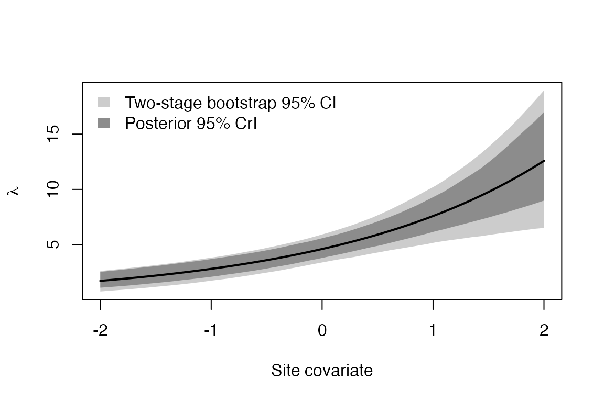
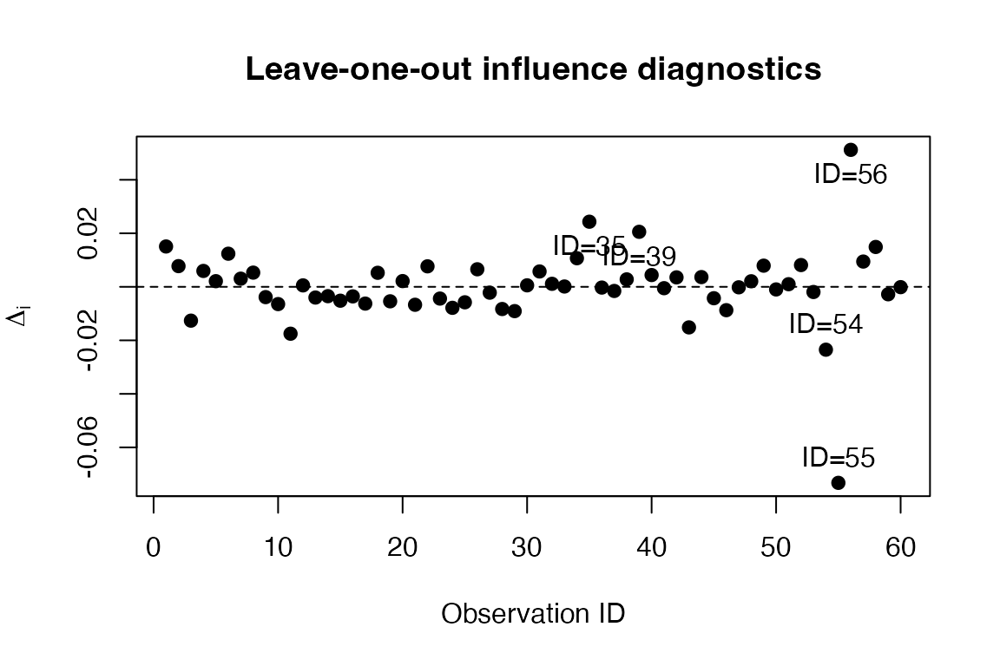

# Two-Stage Bootstrap for N-Mixture Models

\
[`library`](https://rdrr.io/r/base/library.html)`(`[`poscosea`](https://ohkuboyusaku.github.io/poscosea)`)`

## Overview

In a binomial N-mixture model, counts $`y_{ij}`$ are collected at sites
$`i = 1, \ldots, I`$ on repeated visits $`j = 1, \ldots, J`$:

``` math
N_i \sim \mathrm{Poisson}(\lambda_i), \qquad
y_{ij} \mid N_i \sim \mathrm{Binomial}(N_i, p_{ij}).
```

The data are hierarchical, so a bootstrap should resample both levels.
The **two-stage bootstrap** first resamples sites with replacement,
$`u \sim \mathrm{Mult}(I; 1/I, \ldots, 1/I)`$, and then resamples the
observed visits within each selected copy of a site. Instead of
refitting the model for every resample, `poscosea` approximates each
replicate of a posterior mean from a single MCMC run:

``` math
\theta^{(b)} \approx E[\theta]
  + \sum_{i}(u_{bi} - 1)\, c_i
  + \sum_{i,j}(v_{bij} - 1)\, e_{ij},
```

where $`c_i`$ and $`e_{ij}`$ are posterior covariances between
$`\theta`$ and the site-level marginal log-likelihood and the
visit-level log-likelihood, respectively.

The workflow is

1.  [`nmix_draws()`](https://ohkuboyusaku.github.io/poscosea/reference/nmix_draws.md)
    – pick $`\lambda`$, $`p`$ and $`N`$ out of the MCMC output,
2.  [`nmix_loglik()`](https://ohkuboyusaku.github.io/poscosea/reference/nmix_loglik.md)
    – compute the site- and visit-level log-likelihoods,
3.  [`ijk_nmix()`](https://ohkuboyusaku.github.io/poscosea/reference/ijk_nmix.md)
    – compute the influence values for a quantity of interest,
4.  [`ijk_bootstrap_2stage()`](https://ohkuboyusaku.github.io/poscosea/reference/ijk_bootstrap_2stage.md)
    – generate the bootstrap replicates.

## Example data

We simulate data with unmodelled overdispersion in abundance, so that
the fitted Poisson N-mixture model is misspecified.

\
[`set.seed`](https://rdrr.io/r/base/Random.html)`(``1``)`\
`I`` ``<-`` ``60``; ``J`` ``<-`` ``3`\
`x``  ``<-`` `[`rnorm`](https://rdrr.io/r/stats/Normal.html)`(``I``)``                       ``# site covariate`\
`xp`` ``<-`` `[`matrix`](https://rdrr.io/r/base/matrix.html)`(`[`rnorm`](https://rdrr.io/r/stats/Normal.html)`(``I`` ``*`` ``J``)``, ``I``, ``J``)``     ``# visit covariate`\
`lambda_true`` ``<-`` `[`exp`](https://rdrr.io/r/base/Log.html)`(``1.5`` ``+`` ``0.5`` ``*`` ``x`` ``+`` `[`rnorm`](https://rdrr.io/r/stats/Normal.html)`(``I``, ``0``, ``0.5``)``)`\
`N_true`` ``<-`` `[`rpois`](https://rdrr.io/r/stats/Poisson.html)`(``I``, ``lambda_true``)`\
`y`` ``<-`` `[`matrix`](https://rdrr.io/r/base/matrix.html)`(`[`rbinom`](https://rdrr.io/r/stats/Binomial.html)`(``I`` ``*`` ``J``, `[`rep`](https://rdrr.io/r/base/rep.html)`(``N_true``, ``J``)``, `[`plogis`](https://rdrr.io/r/stats/Logistic.html)`(``0.5`` ``*`` ``xp``)``)``, ``I``, ``J``)`\
`y``[`[`c`](https://rdrr.io/r/base/c.html)`(``3``, ``10``, ``25``)``, ``3``]`` ``<-`` ``NA``             ``# some missing visits`

## Posterior draws

In practice the parameter draws come from MCMC (see the last section).
To keep this vignette self-contained, we use a Laplace normal
approximation to the posterior of
$`(\alpha_\lambda, \beta_\lambda, \alpha_p, \beta_p)`$, with independent
weakly informative Normal priors specified below. These are illustrative
posterior draws, not MCMC output. The fitted Poisson model omits the
site-level abundance variation used to generate the data, so the
resulting intervals should not be read as calibrated coverage results.
We draw $`N_i`$ from its conditional posterior.
[`nmix_loglik()`](https://ohkuboyusaku.github.io/poscosea/reference/nmix_loglik.md)
accepts a single draw when evaluating the marginal likelihood during
optimization.

\
`prior_mean`` ``<-`` `[`c`](https://rdrr.io/r/base/c.html)`(``1.5``, ``0``, ``0``, ``0``)`\
`prior_sd`` ``<-`` `[`c`](https://rdrr.io/r/base/c.html)`(``2``, ``1.5``, ``2``, ``2``)`\
\
`nll`` ``<-`` ``function``(``par``)`` ``{`\
`  ``lam`` ``<-`` `[`matrix`](https://rdrr.io/r/base/matrix.html)`(`[`exp`](https://rdrr.io/r/base/Log.html)`(``par``[``1``]`` ``+`` ``par``[``2``]`` ``*`` ``x``)``, ``1``)`\
`  ``p``   ``<-`` `[`matrix`](https://rdrr.io/r/base/matrix.html)`(`[`plogis`](https://rdrr.io/r/stats/Logistic.html)`(``par``[``3``]`` ``+`` ``par``[``4``]`` ``*`` ``xp``)``, ``1``)`\
`  ``log_lik`` ``<-`` `[`sum`](https://rdrr.io/r/base/sum.html)`(`[`suppressWarnings`](https://rdrr.io/r/base/warning.html)`(`[`nmix_loglik`](https://ohkuboyusaku.github.io/poscosea/reference/nmix_loglik.md)`(``y``, ``lam``, ``p``)``$``site``)``)`\
`  ``log_prior`` ``<-`` `[`sum`](https://rdrr.io/r/base/sum.html)`(`[`dnorm`](https://rdrr.io/r/stats/Normal.html)`(``par``, mean ``=`` ``prior_mean``, sd ``=`` ``prior_sd``, log ``=`` ``TRUE``)``)`\
`  ``val`` ``<-`` ``-``log_lik`` ``-`` ``log_prior`\
`  ``if`` ``(`[`is.finite`](https://rdrr.io/r/base/is.finite.html)`(``val``)``)`` ``val`` ``else`` ``1e10`\
`}`\
`opt`` ``<-`` `[`optim`](https://rdrr.io/r/stats/optim.html)`(`[`c`](https://rdrr.io/r/base/c.html)`(``1``, ``0``, ``0``, ``0``)``, ``nll``, method ``=`` ``"BFGS"``, hessian ``=`` ``TRUE``)`\
`if`` ``(``opt``$``convergence`` ``!=`` ``0``)`` `[`stop`](https://rdrr.io/r/base/stop.html)`(``"Posterior mode optimization did not converge."``)`\
`post_cov`` ``<-`` `[`solve`](https://rdrr.io/r/base/solve.html)`(``opt``$``hessian``)`\
\
`S``  ``<-`` ``2000`\
`th`` ``<-`` `[`t`](https://rdrr.io/r/base/t.html)`(``opt``$``par`` ``+`` `[`t`](https://rdrr.io/r/base/t.html)`(`[`chol`](https://rdrr.io/r/base/chol.html)`(``post_cov``)``)`` `[`%*%`](https://rdrr.io/r/base/matmult.html)` `[`matrix`](https://rdrr.io/r/base/matrix.html)`(`[`rnorm`](https://rdrr.io/r/stats/Normal.html)`(``4`` ``*`` ``S``)``, ``4``)``)`\
[`colnames`](https://rdrr.io/r/base/colnames.html)`(``th``)`` ``<-`` `[`c`](https://rdrr.io/r/base/c.html)`(``"alpha.lam"``, ``"beta.lam"``, ``"alpha.p"``, ``"beta.p"``)`\
\
`lambda`` ``<-`` `[`exp`](https://rdrr.io/r/base/Log.html)`(``th``[``, ``1``]`` ``+`` `[`outer`](https://rdrr.io/r/base/outer.html)`(``th``[``, ``2``]``, ``x``)``)``                   ``# S x I`\
`p``      ``<-`` `[`plogis`](https://rdrr.io/r/stats/Logistic.html)`(``th``[``, ``3``]`` ``+`` `[`outer`](https://rdrr.io/r/base/outer.html)`(``th``[``, ``4``]``, `[`as.vector`](https://rdrr.io/r/base/vector.html)`(``xp``)``)``)``    ``# S x IJ`\
\
`## N_i | y_i, theta on the grid max(y_i), ..., max(y_i) + 100`\
`draw_N`` ``<-`` ``function``(``y``, ``lambda``, ``p``, ``Nmax_extra`` ``=`` ``100``)`` ``{`\
`  ``S`` ``<-`` `[`nrow`](https://rdrr.io/r/base/nrow.html)`(``lambda``)``; ``I`` ``<-`` `[`nrow`](https://rdrr.io/r/base/nrow.html)`(``y``)`\
`  ``N`` ``<-`` `[`matrix`](https://rdrr.io/r/base/matrix.html)`(``NA_integer_``, ``S``, ``I``)`\
`  ``for`` ``(``i`` ``in`` `[`seq_len`](https://rdrr.io/r/base/seq.html)`(``I``)``)`` ``{`\
`    ``obs`` ``<-`` `[`which`](https://rdrr.io/r/base/which.html)`(``!`[`is.na`](https://rdrr.io/r/base/NA.html)`(``y``[``i``, ``]``)``)`\
`    ``Ns``  ``<-`` `[`max`](https://rdrr.io/r/base/Extremes.html)`(``y``[``i``, ``obs``]``)`` ``+`` ``0``:``Nmax_extra`\
`    ``Nr``  ``<-`` `[`matrix`](https://rdrr.io/r/base/matrix.html)`(``Ns``, ``S``, `[`length`](https://rdrr.io/r/base/length.html)`(``Ns``)``, byrow ``=`` ``TRUE``)`\
`    ``lt``  ``<-`` `[`dpois`](https://rdrr.io/r/stats/Poisson.html)`(``Nr``, ``lambda``[``, ``i``]``, log ``=`` ``TRUE``)`\
`    ``for`` ``(``j`` ``in`` ``obs``)`` ``lt`` ``<-`` ``lt`` ``+`` `[`dbinom`](https://rdrr.io/r/stats/Binomial.html)`(``y``[``i``, ``j``]``, ``Nr``, ``p``[``, ``i`` ``+`` ``(``j`` ``-`` ``1``)`` ``*`` ``I``]``, log ``=`` ``TRUE``)`\
`    ``cw`` ``<-`` `[`t`](https://rdrr.io/r/base/t.html)`(`[`apply`](https://rdrr.io/r/base/apply.html)`(`[`exp`](https://rdrr.io/r/base/Log.html)`(``lt`` ``-`` `[`apply`](https://rdrr.io/r/base/apply.html)`(``lt``, ``1``, ``max``)``)``, ``1``, ``cumsum``)``)`\
`    ``N``[``, ``i``]`` ``<-`` ``Ns``[`[`rowSums`](https://rdrr.io/r/base/colSums.html)`(``cw`` ``<`` `[`runif`](https://rdrr.io/r/stats/Uniform.html)`(``S``)`` ``*`` ``cw``[``, `[`ncol`](https://rdrr.io/r/base/nrow.html)`(``cw``)``]``)`` ``+`` ``1``]`\
`  ``}`\
`  ``N`\
`}`\
`N`` ``<-`` ``draw_N``(``y``, ``lambda``, ``p``)`

## Log-likelihoods and influence values

[`nmix_loglik()`](https://ohkuboyusaku.github.io/poscosea/reference/nmix_loglik.md)
returns the site-level marginal log-likelihood and two versions of the
visit-level log-likelihood: `obs_rb` (for quantities that depend only on
the parameters) and `obs_joint` (for quantities involving the latent
abundance $`N`$; requires `N`).

\
`ll`` ``<-`` `[`nmix_loglik`](https://ohkuboyusaku.github.io/poscosea/reference/nmix_loglik.md)`(``y``, ``lambda``, ``p``, N ``=`` ``N``)`\
[`str`](https://rdrr.io/r/utils/str.html)`(``ll``[`[`c`](https://rdrr.io/r/base/c.html)`(``"site"``, ``"obs_rb"``, ``"obs_joint"``)``]``)`\
`#> List of 3`\
`#>  $ site     : num [1:2000, 1:60] -5.45 -4.89 -5.4 -4.81 -5.95 ...`\
`#>  $ obs_rb   : num [1:2000, 1:180] -1.128 -0.935 -1.03 -0.848 -1.52 ...`\
`#>  $ obs_joint: num [1:2000, 1:180] -1.209 -0.757 -1.012 -0.673 -1.495 ...`

We draw the bootstrap weights once and share them across quantities.

\
`w`` ``<-`` `[`nmix_weights`](https://ohkuboyusaku.github.io/poscosea/reference/nmix_weights.md)`(``B ``=`` ``5000``, obs_mask ``=`` ``ll``$``obs_mask``)`

### A regression coefficient

\
`fit_beta`` ``<-`` `[`ijk_nmix`](https://ohkuboyusaku.github.io/poscosea/reference/ijk_nmix.md)`(``th``[``, ``"beta.lam"``]``, ``ll``)`\
`boot_two``  ``<-`` `[`ijk_bootstrap_2stage`](https://ohkuboyusaku.github.io/poscosea/reference/ijk_bootstrap_2stage.md)`(``fit_beta``, type ``=`` ``"twostage"``, weights ``=`` ``w``)`\
`boot_site`` ``<-`` `[`ijk_bootstrap_2stage`](https://ohkuboyusaku.github.io/poscosea/reference/ijk_bootstrap_2stage.md)`(``fit_beta``, type ``=`` ``"site"``, weights ``=`` ``w``)`\
`boot_two`\
`#> `\
`#> IJK Bootstrap Summary (N-mixture, type = "twostage")`\
`#> `\
`#> Bootstrap replicates: 5000 `\
`#> `\
`#>   estimate      bias   se lower upper`\
`#> 1    0.498 -5.33e-05 0.11 0.286 0.722`

\
[`rbind`](https://rdrr.io/r/base/cbind.html)`(`\
`  posterior ``=`` `[`c`](https://rdrr.io/r/base/c.html)`(``estimate ``=`` `[`mean`](https://rdrr.io/r/base/mean.html)`(``th``[``, ``"beta.lam"``]``)``, se ``=`` `[`sd`](https://rdrr.io/r/stats/sd.html)`(``th``[``, ``"beta.lam"``]``)``,`\
`                `[`setNames`](https://rdrr.io/r/stats/setNames.html)`(`[`quantile`](https://rdrr.io/r/stats/quantile.html)`(``th``[``, ``"beta.lam"``]``, `[`c`](https://rdrr.io/r/base/c.html)`(``0.025``, ``0.975``)``)``, `[`c`](https://rdrr.io/r/base/c.html)`(``"lower"``, ``"upper"``)``)``)``,`\
`  site      ``=`` `[`unlist`](https://rdrr.io/r/base/unlist.html)`(`[`summary`](https://rdrr.io/r/base/summary.html)`(``boot_site``)``[`[`c`](https://rdrr.io/r/base/c.html)`(``"estimate"``, ``"se"``, ``"lower"``, ``"upper"``)``]``)``,`\
`  twostage  ``=`` `[`unlist`](https://rdrr.io/r/base/unlist.html)`(`[`summary`](https://rdrr.io/r/base/summary.html)`(``boot_two``)``[`[`c`](https://rdrr.io/r/base/c.html)`(``"estimate"``, ``"se"``, ``"lower"``, ``"upper"``)``]``)`\
`)`\
`#>            estimate         se     lower     upper`\
`#> posterior 0.4978255 0.08037342 0.3430796 0.6581175`\
`#> site      0.4978255 0.10925440 0.2893603 0.7233496`\
`#> twostage  0.4978255 0.11003653 0.2857569 0.7216042`

### The total abundance of the surveyed sites

$`\sum_i N_i`$ depends on the latent abundance, so we use
`obs = "joint"`. The likelihood weights only capture the variation
through the parameters;
[`nmix_latent_resid()`](https://ohkuboyusaku.github.io/poscosea/reference/nmix_latent_resid.md)
adds the prediction error of $`N`$.

\
`Ntot`` ``<-`` `[`rowSums`](https://rdrr.io/r/base/colSums.html)`(``N``)`\
`fit_N`` ``<-`` `[`ijk_nmix`](https://ohkuboyusaku.github.io/poscosea/reference/ijk_nmix.md)`(``Ntot``, ``ll``, obs ``=`` ``"joint"``)`\
[`summary`](https://rdrr.io/r/base/summary.html)`(`[`ijk_bootstrap_2stage`](https://ohkuboyusaku.github.io/poscosea/reference/ijk_bootstrap_2stage.md)`(``fit_N``, weights ``=`` ``w``,`\
`                             latent_resid ``=`` `[`nmix_latent_resid`](https://ohkuboyusaku.github.io/poscosea/reference/nmix_latent_resid.md)`(``N``, ``ll``)``)``)`\
`#>   estimate       bias       se    lower  upper`\
`#> 1  318.402 -0.4242808 35.25975 250.8748 389.72`\
[`quantile`](https://rdrr.io/r/stats/quantile.html)`(``Ntot``, `[`c`](https://rdrr.io/r/base/c.html)`(``0.025``, ``0.975``)``)``      ``# posterior interval`\
`#>  2.5% 97.5% `\
`#>   281   371`\
[`sum`](https://rdrr.io/r/base/sum.html)`(``N_true``)``                          ``# realised value`\
`#> [1] 374`

### Several quantities at once: a regression curve

A matrix `theta` (draws in rows, quantities in columns) gives replicates
for all quantities with the same resamples.

\
`xg`` ``<-`` `[`seq`](https://rdrr.io/r/base/seq.html)`(``-``2``, ``2``, length.out ``=`` ``50``)`\
`lam_curve`` ``<-`` `[`exp`](https://rdrr.io/r/base/Log.html)`(``th``[``, ``"alpha.lam"``]`` ``+`` `[`outer`](https://rdrr.io/r/base/outer.html)`(``th``[``, ``"beta.lam"``]``, ``xg``)``)``   ``# S x 50`\
`fit_curve`` ``<-`` `[`ijk_nmix`](https://ohkuboyusaku.github.io/poscosea/reference/ijk_nmix.md)`(``lam_curve``, ``ll``)`\
`sc`` ``<-`` `[`summary`](https://rdrr.io/r/base/summary.html)`(`[`ijk_bootstrap_2stage`](https://ohkuboyusaku.github.io/poscosea/reference/ijk_bootstrap_2stage.md)`(``fit_curve``, weights ``=`` ``w``)``)`\
`pq`` ``<-`` `[`apply`](https://rdrr.io/r/base/apply.html)`(``lam_curve``, ``2``, ``quantile``, `[`c`](https://rdrr.io/r/base/c.html)`(``0.025``, ``0.975``)``)`\
\
[`plot`](https://rdrr.io/r/graphics/plot.default.html)`(``xg``, ``sc``$``estimate``, type ``=`` ``"n"``, ylim ``=`` `[`range`](https://rdrr.io/r/base/range.html)`(``sc``$``lower``, ``sc``$``upper``, ``pq``)``,`\
`     xlab ``=`` ``"Site covariate"``, ylab ``=`` `[`expression`](https://rdrr.io/r/base/expression.html)`(``lambda``)``)`\
[`polygon`](https://rdrr.io/r/graphics/polygon.html)`(`[`c`](https://rdrr.io/r/base/c.html)`(``xg``, `[`rev`](https://rdrr.io/r/base/rev.html)`(``xg``)``)``, `[`c`](https://rdrr.io/r/base/c.html)`(``sc``$``lower``, `[`rev`](https://rdrr.io/r/base/rev.html)`(``sc``$``upper``)``)``, col ``=`` ``"grey80"``, border ``=`` ``NA``)`\
[`polygon`](https://rdrr.io/r/graphics/polygon.html)`(`[`c`](https://rdrr.io/r/base/c.html)`(``xg``, `[`rev`](https://rdrr.io/r/base/rev.html)`(``xg``)``)``, `[`c`](https://rdrr.io/r/base/c.html)`(``pq``[``1``, ``]``, `[`rev`](https://rdrr.io/r/base/rev.html)`(``pq``[``2``, ``]``)``)``, col ``=`` ``"grey55"``, border ``=`` ``NA``)`\
[`lines`](https://rdrr.io/r/graphics/lines.html)`(``xg``, ``sc``$``estimate``, lwd ``=`` ``2``)`\
[`legend`](https://rdrr.io/r/graphics/legend.html)`(``"topleft"``, `[`c`](https://rdrr.io/r/base/c.html)`(``"Two-stage bootstrap 95% CI"``, ``"Posterior 95% CrI"``)``,`\
`       fill ``=`` `[`c`](https://rdrr.io/r/base/c.html)`(``"grey80"``, ``"grey55"``)``, border ``=`` ``NA``, bty ``=`` ``"n"``)`



### Leave-one-site-out

The site-level influence values can be passed to
[`ijk_lko()`](https://ohkuboyusaku.github.io/poscosea/reference/ijk_lko.md).

\
`loo`` ``<-`` `[`ijk_lko`](https://ohkuboyusaku.github.io/poscosea/reference/ijk_lko.md)`(``fit_beta``$``estimate``, ``fit_beta``$``influence_site``, k ``=`` ``1``)`\
[`plot`](https://rdrr.io/r/graphics/plot.default.html)`(``loo``)`



## Using MCMC output

With JAGS (here through `runjags`), monitor $`\lambda`$, $`p`$ and $`N`$
and pass the draws to
[`nmix_draws()`](https://ohkuboyusaku.github.io/poscosea/reference/nmix_draws.md).
Columns are matched by name (`lam[i]`, `p[i,j]`, `N[i]`), so their order
in the output does not matter.

\
[`library`](https://rdrr.io/r/base/library.html)`(`[`runjags`](https://github.com/ku-awdc/runjags)`)`\
`fit`` ``<-`` `[`run.jags`](https://rdrr.io/pkg/runjags/man/run.jags.html)`(``"Nmix.txt"``, monitor ``=`` `[`c`](https://rdrr.io/r/base/c.html)`(``"beta"``, ``"lam"``, ``"p"``, ``"N"``)``,`\
`                data ``=`` ``jags_data``, n.chains ``=`` ``3``)`\
`dr`` ``<-`` `[`nmix_draws`](https://ohkuboyusaku.github.io/poscosea/reference/nmix_draws.md)`(``as.mcmc.list``(``fit``)``, I ``=`` `[`nrow`](https://rdrr.io/r/base/nrow.html)`(``y``)``, J ``=`` `[`ncol`](https://rdrr.io/r/base/nrow.html)`(``y``)``,`\
`                 lambda ``=`` ``"lam"``, p ``=`` ``"p"``, N ``=`` ``"N"``)`\
`ll`` ``<-`` `[`nmix_loglik`](https://ohkuboyusaku.github.io/poscosea/reference/nmix_loglik.md)`(``y``, ``dr``$``lambda``, ``dr``$``p``, N ``=`` ``dr``$``N``)`

If the detection model contains random effects, the monitored $`p_{ij}`$
are conditional on them and
[`nmix_loglik()`](https://ohkuboyusaku.github.io/poscosea/reference/nmix_loglik.md)
returns the likelihood conditional on those random effects.
